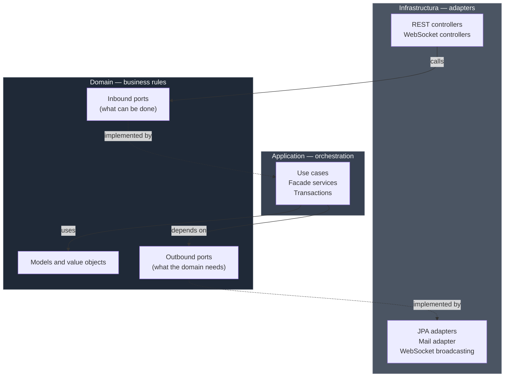
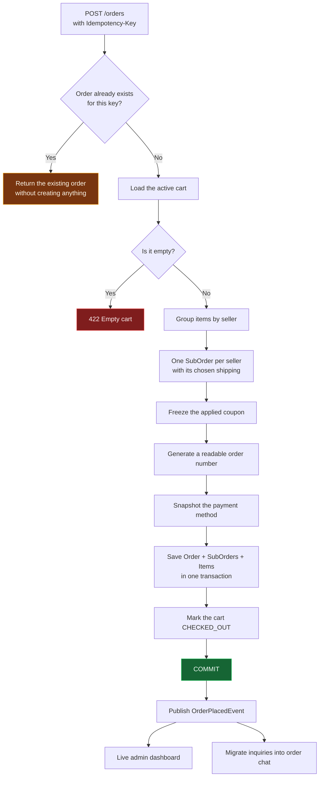

# Marketplace Hexagonal

Backend for a multi-vendor marketplace built with Spring Boot 4 and Java 21, following hexagonal architecture (ports and adapters) without shortcuts.

*Léelo en [español](README.md).*

It's a real marketplace: multiple sellers share a catalog, a single order splits into independent sub-orders that each store fulfills at its own pace, stock is held while a cart is alive, and buyers and sellers talk in real time both before and after the purchase.

---

## Contents

- [Why this project exists](#why-this-project-exists)
- [Stack](#stack)
- [Architecture](#architecture)
- [How the application works](#how-the-application-works)
  - [Identity and access](#1-identity-and-access)
  - [Product catalog](#2-product-catalog)
  - [Sellers and stores](#3-sellers-and-stores)
  - [Shopping cart](#4-shopping-cart)
  - [Discount coupons](#5-discount-coupons)
  - [Shipping](#6-shipping)
  - [Checkout and orders](#7-checkout-and-orders)
  - [Reviews](#8-reviews)
  - [Favorites](#9-favorites)
  - [Messaging](#10-messaging)
  - [Admin panel](#11-admin-panel)
  - [Email notifications](#12-email-notifications)
  - [Real time](#13-real-time)
- [Technical decisions](#technical-decisions)
- [Getting started](#getting-started)
- [Tests](#tests)
- [Current state and limitations](#current-state-and-limitations)
- [Where it's headed](#where-its-headed)

---

## Why this project exists

Most hexagonal architecture examples out there stop at a toy domain: three entities, two use cases, and no genuine conflict between business rules. The architecture looks clean because nothing is pushing on it.

A multi-vendor marketplace pushes. The order doesn't belong to a single actor. Stock is contested between concurrent carts. A purchase's state isn't a linear enum but several advancing in parallel. And side effects are everywhere: emails, live notifications, admin metrics, conversation threads that change context the moment the buyer pays.

This repository is my answer to that pressure: 603 production classes organized by business context, where the domain knows nothing about Spring, nothing about JPA, and nothing about HTTP.

---

## Stack

| Component | Choice | Note |
|---|---|---|
| Language | Java 21 |  |
| Framework | Spring Boot 4.0.6 | Web MVC, Security, Data JPA, Validation, Mail, Actuator |
| Database | PostgreSQL | Hibernate as ORM |
| Authentication | JWT (jjwt 0.12.6) | Access token plus rotating refresh token |
| Real time | WebSocket + STOMP | With SockJS fallback |
| Mapping | MapStruct 1.6.3 | Compile-time generation |
| Boilerplate | Lombok | |
| Testing | JUnit 5, Mockito, H2 | 70 test classes |

---

## Architecture

The code splits into three layers and the dependency rule only points inward. `Domain` imports nothing from `Application` or `Infrastructura`. `Application` knows the domain but has no idea a database exists.



The dotted arrows are dependency inversion: the port lives in the domain, the implementation in infrastructure. Swapping PostgreSQL for MongoDB means writing new adapters without touching a single line of `Domain`.

### Package layout

```
com.marketplace.hexagonal
├── Domain/                       Core. No framework annotations.
│   └── <Context>/
│       ├── Models/               Entities and value objects
│       ├── Events/               Domain events
│       ├── Exceptions/           Business exceptions
│       └── Ports/
│           ├── In/               Use case interfaces
│           └── Out/              Repository and external service interfaces
│
├── Application/                  Use case implementations
│   └── <Context>/
│       ├── UseCases/             One file, one business operation
│       └── Services/             Facades that group use cases and open transactions
│
└── Infrastructura/               Everything touching the outside world
    ├── Controllers/              26 REST controllers plus 2 WebSocket ones
    ├── Adapters/                 JPA persistence, mail, live broadcasting
    ├── Entities/                 JPA entities (separate from domain models)
    ├── Mappers/                  MapStruct between entity, domain, and DTO
    ├── Events/                   Application event listeners
    ├── Jobs/                     Scheduled tasks
    ├── Security/                 JWT filters, rate limiting, STOMP interceptor
    ├── Specifications/           Dynamic JPA Criteria queries
    └── Config/                   Security, WebSocket, bean wiring, seed data
```

There are thirteen contexts: `Auth`, `User`, `Product`, `Seller`, `Cart`, `Coupon`, `Shipping`, `Order`, `Review`, `Favorite`, `Chat`, `Inquiry`, `Admin`. Each mirrors that same internal structure, so moving between modules never requires relearning anything.

One detail worth calling out: domain models and JPA entities are distinct classes. It's more code, yes, but it keeps relational mapping decisions from leaking into business rules. `Product` has no `@Entity` and no `@ManyToOne`; it has a `publish()` method that checks for price, stock, and images before letting a draft go public.

---

## How the application works

### 1. Identity and access

**Two-step registration.** Nobody gets an account just by typing an email. `POST /auth/register` doesn't create the user: it stores a pending registration with the password already hashed and mails a six-digit code to the address given. The database keeps the hash of the code, not the code. The real user is born at `POST /auth/verify-email`, when the code matches and the 15-minute window hasn't closed. If it expires, `POST /auth/resend-code` issues a fresh one and discards the old.

**Login.** `POST /auth/login` returns a 15-minute access token, a 7-day refresh token, and the basic profile (id, name, roles, avatar) so the client can render the UI without a second round trip. The refresh token is stored SHA-256 hashed: dumping the table yields no usable sessions.

**Rotating refresh.** `POST /auth/refresh` invalidates the token you handed in and issues a new one. Rotation means a stolen refresh token works exactly once and leaves a trace when it does. Renewal is explicit — the client decides when to call, the server never renews on its own.

**Logout and recovery.** `POST /auth/logout` deletes the refresh token server-side. `POST /auth/forgot-password` and `POST /auth/reset-password` cover forgotten passwords with a single-use emailed token.

**Brute force brake.** A filter ahead of the security chain counts failed `POST /auth/login` attempts in a sliding window: five failures from one IP within 15 minutes and further requests get a 429. A successful login clears the counter. The implementation is in-memory and self-aware about it: fine for one instance, and the code itself documents that distributed deployments need to move it to Redis.

**Roles and permissions.** Five roles (`ADMIN`, `BUYER`, `SELLER`, `SUPPORT`, `DEVELOPER`), each with a default permission set seeded at startup. Authorization works at two levels: path rules in `SecurityConfig` and `@PreAuthorize` on specific methods when the rule depends on the resource.

### 2. Product catalog

**Hierarchical categories.** A category tree with readable slugs for friendly URLs. Public browsing (`GET /categories`, `/categories/slug/{slug}`, `/categories/{id}/subcategories`) needs no session; creating, editing, activating, and deactivating are admin-only.

**Three product types.** `PHYSICAL` for tangible goods that ship, `DIGITAL` for downloads delivered by link, `SERVICE` for intangible offerings. The type drives which rules apply downstream.

**An explicit lifecycle.** A product starts as `DRAFT`, visible only to its seller. `PATCH /products/{id}/publish` moves it to `ACTIVE` after validating the minimum required data. `INACTIVE` hides it without losing history and is reversible. `DELETED` is a terminal soft delete, so old orders keep their reference intact.

**Variants.** A product can carry variants with their own SKU, price, and stock (size, color, format). Variants are managed independently through `POST`, `PUT`, and `DELETE` under `/products/{id}/variants`.

**Images.** An ordered collection per product with one marked as primary. Dedicated endpoints add, remove, and designate the cover image.

**Search.** `GET /products/search` combines keyword, category, seller, price range, and product type. The query is assembled through JPA Criteria with composable Specifications, so absent filters simply produce no predicate instead of turning into a `WHERE 1=1` padded with dead conditions. Results come back paginated in a domain-owned `PageResult`, not Spring's `Page`, to keep the framework out of the core.

**Low stock alerts.** When a sale drops inventory below the threshold, a `LowStockAlertEvent` fires and the seller gets the warning on their private WebSocket channel without refreshing the dashboard.

### 3. Sellers and stores

**Application.** Any authenticated user can apply via `POST /seller/apply` with store details, identity document, and banking information. The profile lands in `PENDING_APPROVAL`.

**Admin review.** From `/admin/sellers` an administrator lists pending applications, inspects the detail, and decides: approve (`ACTIVE`, and the user gains the `SELLER` role), reject with a reason, suspend temporarily, reactivate, or permanently ban. The valid transitions are declared on the `SellerStatus` enum itself rather than scattered across service conditionals.

**Retry.** A rejection isn't final: from `REJECTED` or `CANCELLED` the user can return to `PENDING_APPROVAL` after fixing what was flagged. They can also withdraw an application while it's still pending.

**Public storefront.** `GET /stores` returns active stores for the homepage showcase, and `GET /stores/{sellerId}` serves a store page with its active products, paginated. If the store isn't active the response is a 404: a suspended seller disappears from public view without leaving an orphan page behind.

**Seller dashboard.** `GET /seller/dashboard` summarizes sales, orders, and catalog status for whoever is asking.

### 4. Shopping cart

**Works without an account.** A visitor can add products using a session identifier. No signup required to fill a cart, which is exactly where a lot of stores lose the buyer.

**Merge on login.** `POST /cart/merge` combines the anonymous cart with the authenticated user's cart, adding quantities for the same product instead of duplicating lines or discarding what was already there.

**Stock reservation.** Adding an item creates a `StockReservation` with an expiry. While it lives, those units aren't promised to anyone else. When it lapses, the stock returns to circulation. This heads off the classic case of two people buying the last unit at the same moment.

**Price change detection.** The cart records the price each item was added at. If the seller changes it afterward, fetching the cart returns the difference explicitly so the frontend can show it before charging. Nobody pays a different price than the one they saw without being told.

**Coupons.** `POST /cart/coupon` applies a code and `DELETE /cart/coupon` removes it. Full validation happens at the moment of application.

**Automatic cleanup.** A scheduled job marks inactive carts as `ABANDONED` and releases their reservations. The cadence is cron-configurable (`cart.expiration.cron`).

### 5. Discount coupons

Managed from `/admin/coupons`. Each coupon defines a discount type (`PERCENTAGE` or `FIXED_AMOUNT`), a value, a minimum order amount, a global usage cap, a validity window, and an active flag.

The rules live in the domain model, not the controller: a percentage outside 0–100 or a non-positive fixed amount fails at construction. Codes are normalized to uppercase and trimmed, so `summer2026` and ` SUMMER2026 ` are the same coupon. Activating and deactivating are separate from creation, so a promotion can be switched off without erasing its usage history.

### 6. Shipping

Each seller defines their own shipping options under `/seller/shipping-options`: name, description, price, and estimated day range. They can be activated and deactivated without deletion.

During checkout, `GET /checkout/shipping` returns one quote per seller: the subtotal of their items and the options available for that group. Since a cart can span several stores, the buyer picks a shipping method per store rather than one global option. The endpoint is public because buyers need to see the cost before deciding to create an account.

### 7. Checkout and orders

This is where the domain gets interesting.



**Real idempotency.** The client sends an `Idempotency-Key` header. If the request repeats because of a double click, a network retry, or an impatient user, the server returns the order it already created instead of double-charging. The check runs first, before the cart is even touched.

**One order, several sub-orders.** The cart is grouped by seller and each group becomes a `SubOrder` with its own items, its own shipping cost, and its own status. The buyer sees a single purchase with a single total; each store sees only its share.

**States that advance in parallel.** A `SubOrder` walks `PENDING_PAYMENT → PAID → PROCESSING → SHIPPED → DELIVERED`, with `CANCELLED` and `REFUNDED` as exits. What matters is that they advance independently: if one store ships today and another in three days, neither waits on the other. The parent order's status is derived from the set.

**Immutable snapshots.** The order stores a copy of the product name and price, the store name, the applied coupon, and the payment method's last digits. If the seller renames the product tomorrow or deletes the card, the historical order still tells the truth about that day.

**All or nothing.** Inserting the order, all its sub-orders, all its items, and closing the cart happen in a single transaction. There's no intermediate state where an order exists while the cart is still open.

**Three ways to cancel.** The buyer cancels their own order (`PATCH /orders/{id}/cancel`), the seller cancels their portion (`PATCH /seller/orders/{id}/cancel`), and the admin can cancel any of them (`PATCH /admin/orders/{id}/cancel`). Each path carries its own validations and all publish an `OrderCancelledEvent` identifying who did it.

**The seller's view.** Under `/seller/orders` each store sees only its own sub-orders and updates fulfillment status with `PATCH /seller/orders/{subOrderId}/status`. The change pushes a live notification to the buyer and to the admin panel.

### 8. Reviews

Two possible targets: products (`/products/{id}/reviews`) and sellers (`/sellers/{id}/reviews`). Reading is public; writing requires a session.

The rules live in the domain and there are three. You can't review your own content, checked before saving. You can't review the same thing twice — the second attempt returns a 409. And the rating must fall in the valid range, enforced in the value object.

Authors can delete their own review. Admins can delete any review through a separate route (`DELETE /admin/reviews/{id}`), which makes it obvious from the API design alone which operation is moderation and which is self-service.

### 9. Favorites

A per-user wishlist under `/user/favorites`. Saving an already-saved product returns 409 rather than silently creating a duplicate; removing one that isn't there returns 404. Small, but it's the difference between an API that answers precisely and one that always says "ok".

### 10. Messaging

Three pieces and one transition between them — probably the part of this project I'm happiest with.

**Questions before buying.** An interested buyer opens a thread about a product via `POST /products/{productId}/inquiries`. The thread is unique per (product, buyer) pair and has exactly two participants: the one asking and the one selling. No admins watching. Messages travel over WebSocket at `/app/inquiry.send` and land on the thread's channel, with a notification to the recipient if they aren't connected at that moment. Either party can close the thread, and a scheduled job deletes threads idle for more than a day, with a configurable threshold.

**Conversation after buying.** Once an order exists, rooms anchored to it open up. `BUYER_SELLER` connects the buyer with one specific store from that purchase, so an order spanning three sellers has three separate conversations. `BUYER_SUPPORT` connects the buyer with the support team, where any admin can respond.

**The migration.** When the buyer finally pays, their earlier questions about that product aren't lost or stranded on another screen. On order confirmation, a listener finds open threads whose products were just purchased and copies the full history into the order's room, preserving sender, content, and original timestamp. Then it deletes the inquiry thread. The buyer opens their order chat and finds the whole conversation, from "does it come with a warranty?" through "your package just shipped".

Two details about that migration. It runs after commit, so it always reads confirmed data. And if it fails, it fails alone: the error is logged and the order proceeds, because nobody should lose a purchase over a message copy going sideways.

**Support expiry.** Support rooms are deleted after a few minutes of inactivity (five by default), taking their messages with them via cascade. A job checks every minute, which keeps accuracy within ±60 seconds without punishing the database.

### 11. Admin panel

**Live metrics.** `GET /admin/dashboard` returns GMV, orders today, signups today, active users, all-time order count, and a breakdown by status. And it doesn't sit still: every time someone buys, every connected admin's panel updates itself over WebSocket.

**Commission.** The platform rate is read and changed at `/admin/commission`. Updating doesn't overwrite: it inserts a new row and returns the current one, so there's a trail of which rate applied when.

**Users.** Filterable listing, detail view, block and unblock from `/admin/users`.

**Orders.** `/admin/orders` searches every order on the platform with combined criteria and cancels when intervention is needed.

**Sellers, categories, and coupons** are managed through the routes already described.

### 12. Email notifications

SMTP delivery with HTML templates prepared for each moment of the journey: welcome, verification code, password recovery, seller approval, order confirmation with the item breakdown, shipping confirmation with a tracking link, and a review request after delivery.

The domain doesn't know SMTP exists. It only declares a port (`EmailNotificationPort`) describing what it needs; the JavaMail adapter satisfies it. Moving to SendGrid or Amazon SES means writing another adapter.

### 13. Real time

STOMP over WebSocket at the `/ws` endpoint, with a SockJS fallback for older browsers.

Authentication doesn't happen on the HTTP handshake but on the STOMP `CONNECT` frame: a channel interceptor validates the JWT before any subscription is processed. No connection subscribes to a destination without first proving who it is.

| Destination | Who listens | What arrives |
|---|---|---|
| `/topic/admin/dashboard` | Admins | Metrics refreshed after every purchase |
| `/topic/admin/order-updates` | Admins | Status changes on any order |
| `/user/queue/order-status` | Buyer | Progress and cancellations on their orders |
| `/user/queue/seller-notifications` | Seller | Low stock alerts and verification outcome |
| `/topic/chat/{roomId}` | Participants | Messages in the order room |
| `/topic/inquiry/{threadId}` | Participants | Messages in the inquiry thread |
| `/user/queue/chat-notify` | Recipient | New message alert while outside the room |
| `/user/queue/inquiry-notify` | Recipient | New question or reply alert |

The buyer subscribes to a single channel for everything order-related, whether that's fulfillment progress or cancellations. Fewer subscriptions on the frontend, less state to keep in sync.

---

## Technical decisions

**Events fire after commit.** Every listener uses `@TransactionalEventListener(phase = AFTER_COMMIT)`. The reason is concrete: a listener querying stats before commit can read data that doesn't exist yet for anyone else, and announce over WebSocket an order that later rolls back. Waiting for commit removes that entire class of bug.

**Side effects never take down the main operation.** Each listener wraps its work in a try/catch that logs and swallows. If the WebSocket broker is down, the buyer still completes the purchase. The notification is garnish; the transaction is the product.

**Typed identifiers instead of String.** `OrderId`, `ProductId`, `UserId`, `SellerProfileId` and friends are value objects. Passing a product id where a user id is expected doesn't compile, rather than failing in production with a baffling 404.

**Money as `BigDecimal` wrapped in `Money`.** Never `double`. The `Money` object carries amount and currency together, which makes it impossible to accidentally add two different currencies.

**Errors in RFC 7807 format.** The global handler translates each business exception into a `ProblemDetail` with the right HTTP code: 404 for missing resources, 409 for conflicts like a duplicate review, 422 for violated business rules, 403 for reaching into someone else's data. Clients can program against the response instead of parsing message strings.

**One file per use case.** `AddToCartUseCaseImpl`, `PlaceOrderUseCaseImpl`, `ApproveSellerUseCaseImpl`. Facade services only compose and set transaction boundaries. Finding where a rule lives means searching for its name, not reading a thousand-line class.

**Beans are wired explicitly.** Application classes carry no `@Service`; they're declared as beans in `ApplicationConfig`. It's more verbose, and that's the point: the core can be instantiated and tested with no container involved.

---

## Getting started

**Requirements:** JDK 21 and PostgreSQL 14 or newer. Maven isn't needed — the wrapper is included.

**1. Create the database**

```sql
CREATE DATABASE "Marketplace_db";
```

**2. Configure the environment**

The application reads these variables and falls back to development defaults when they're absent. Any real deployment should define all of them:

| Variable | Purpose |
|---|---|
| `DB_URL` | PostgreSQL JDBC URL |
| `DB_USERNAME` / `DB_PASSWORD` | Database credentials |
| `JWT_SECRET` | Signing key, 32 characters minimum |
| `JWT_EXPIRATION_MS` | Access token lifetime (900000 = 15 min) |
| `JWT_REFRESH_EXPIRATION_MS` | Refresh token lifetime (604800000 = 7 days) |
| `MAIL_USERNAME` / `MAIL_PASSWORD` | Sending SMTP account |
| `ADMIN_EMAIL` / `ADMIN_PASSWORD` | Administrator created on first boot |
| `CART_EXPIRATION_CRON` | Cart cleanup cadence |

**3. Run it**

```bash
./mvnw spring-boot:run
```

On Windows: `mvnw.cmd spring-boot:run`

The API comes up at `http://localhost:8080`. First boot seeds permissions, roles, and the admin user. Hibernate creates the schema automatically (`ddl-auto=update`), convenient in development; production calls for `validate` alongside versioned migrations.

**Check that it's alive:**

```bash
curl http://localhost:8080/actuator/health
```

---

## Tests

```bash
./mvnw test
```

70 test classes across three levels:

**Domain.** Pure business rules with no framework: order state transitions, sub-order total calculation, coupon validation, product lifecycle, seller status changes.

**Application.** Use cases against mocked dependencies: what happens when the cart is empty, when the coupon has expired, when someone tries to review their own product, when an idempotency key repeats.

**Infrastructure.** Controllers under MockMvc verifying status codes and authorization rules, event listeners, scheduled jobs, and the rate limit filter.

Integration tests that need a database use in-memory H2, so the suite runs without external infrastructure.

---

## Current state and limitations

I'd rather say this here than have someone discover it while reading the code.

**Payments are simulated.** The order stores a payment method reference and its last digits, but there's no gateway integration. The flow is designed to accommodate one: `PaymentInfo` is the natural entry point and the `PENDING_PAYMENT` status already sits there waiting on external confirmation.

**Kafka is declared but unused.** The dependency is in the `pom.xml` from an early design that contemplated distributed events. Messaging today runs on Spring application events, which for a single-instance deployment is the correct tool rather than the one that sounds better.

**Rate limiting is in-memory.** Fine on one instance. Across several, each keeps its own counter and the effective limit multiplies. Moving it to Redis is pending, and the code notes it where it matters.

**No OpenAPI or Docker yet.** The API is documented today through Javadoc on the controllers and this README. There's no `docker-compose` to bring up PostgreSQL alongside the app.

**Images are handled by URL.** No file upload, no cloud storage; the system stores links to images hosted elsewhere.

**No CI configured.** Tests run locally.

---

## Where it's headed

Roughly in priority order:

1. Real payment integration, starting with a gateway using webhooks to confirm charges and advance statuses automatically.
2. `docker-compose` with PostgreSQL so the project starts with one command.
3. Versioned migrations with Flyway, replacing `ddl-auto=update`.
4. Generated OpenAPI documentation with a Swagger UI.
5. Redis-backed rate limiting, so horizontal deployment doesn't weaken it.
6. A CI pipeline running the full suite with a coverage report.
7. Image upload to object storage.

---

## License and authorship

A personal project by [Dleonariza](https://github.com/Dleonariza), built as a serious exercise in hexagonal architecture over a domain with genuine complexity.

If you're going to review the code and only have time for three files, I'd suggest these:

- `Application/Order/UseCases/PlaceOrderUseCaseImpl.java` — the full checkout logic, with idempotency and per-seller splitting.
- `Infrastructura/Events/InquiryToChatMigrationListener.java` — how two contexts talk without coupling.
- `Domain/Cart/Models/Cart.java` — a domain aggregate with its own rules and zero framework dependencies.
