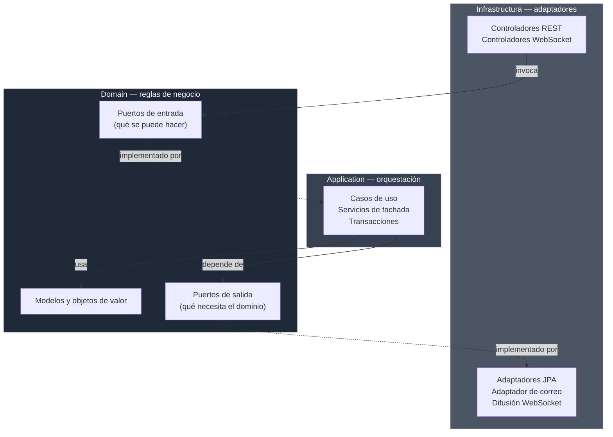
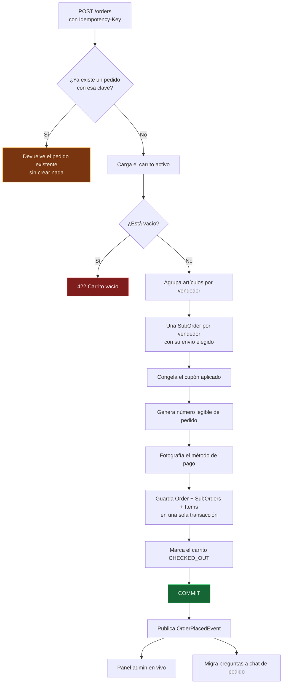

# Marketplace Hexagonal

Backend de un marketplace multivendedor construido con Spring Boot 4 y Java 21, siguiendo arquitectura hexagonal (puertos y adaptadores) de forma estricta.

*Read this in [English](README.EN.md).*

No es un CRUD con carpetas bonitas. Es un marketplace real: varios vendedores comparten catálogo, un mismo pedido se parte en subórdenes independientes que cada tienda despacha a su ritmo, el stock se reserva mientras el carrito está vivo, y compradores y vendedores conversan en tiempo real antes y después de la compra.

---

## Índice

- [Por qué existe este proyecto](#por-qué-existe-este-proyecto)
- [Stack](#stack)
- [Arquitectura](#arquitectura)
- [Cómo funciona la aplicación](#cómo-funciona-la-aplicación)
  - [Identidad y acceso](#1-identidad-y-acceso)
  - [Catálogo de productos](#2-catálogo-de-productos)
  - [Vendedores y tiendas](#3-vendedores-y-tiendas)
  - [Carrito de compras](#4-carrito-de-compras)
  - [Cupones de descuento](#5-cupones-de-descuento)
  - [Envíos](#6-envíos)
  - [Checkout y pedidos](#7-checkout-y-pedidos)
  - [Reseñas](#8-reseñas)
  - [Favoritos](#9-favoritos)
  - [Mensajería](#10-mensajería)
  - [Panel de administración](#11-panel-de-administración)
  - [Notificaciones por correo](#12-notificaciones-por-correo)
  - [Tiempo real](#13-tiempo-real)
- [Decisiones técnicas](#decisiones-técnicas)
- [Puesta en marcha](#puesta-en-marcha)
- [Pruebas](#pruebas)
- [Estado actual y limitaciones](#estado-actual-y-limitaciones)
- [Hacia dónde va](#hacia-dónde-va)

---

## Por qué existe este proyecto

La mayoría de los ejemplos de arquitectura hexagonal que circulan por ahí se quedan en un dominio de juguete: tres entidades, dos casos de uso y ningún conflicto real entre reglas de negocio. La arquitectura se ve limpia porque nada la presiona.

Un marketplace multivendedor sí la presiona. El pedido no pertenece a un solo actor. El stock se disputa entre carritos concurrentes. El estado de una compra no es un enum lineal, sino varios avanzando en paralelo. Y hay efectos secundarios por todos lados: correos, notificaciones en vivo, métricas de administración, hilos de conversación que cambian de contexto cuando el comprador paga.

Este repositorio es mi respuesta a esa presión: 603 clases de producción organizadas por contexto de negocio, donde el dominio no conoce Spring, no conoce JPA y no conoce HTTP.

---

## Stack

| Componente | Elección | Nota |
|---|---|---|
| Lenguaje | Java 21 |  |
| Framework | Spring Boot 4.0.6 | Web MVC, Security, Data JPA, Validation, Mail, Actuator |
| Base de datos | PostgreSQL | Hibernate como ORM |
| Autenticación | JWT (jjwt 0.12.6) | Access token + refresh token rotativo |
| Tiempo real | WebSocket + STOMP | Con fallback SockJS |
| Mapeo | MapStruct 1.6.3 | Generación en tiempo de compilación |
| Boilerplate | Lombok | |
| Pruebas | JUnit 5, Mockito, H2 | 70 clases de prueba |

---

## Arquitectura

El código está dividido en tres capas y la regla de dependencia solo apunta hacia adentro. `Domain` no importa nada de `Application` ni de `Infrastructura`. `Application` conoce el dominio, pero ignora que existe una base de datos.



Las flechas punteadas son la inversión de dependencias: el puerto vive en el dominio, la implementación en infraestructura. Cambiar PostgreSQL por MongoDB significa escribir nuevos adaptadores sin tocar una sola línea de `Domain`.

### Estructura de paquetes

```
com.marketplace.hexagonal
├── Domain/                       Núcleo. Sin anotaciones de framework.
│   └── <Contexto>/
│       ├── Models/               Entidades y objetos de valor
│       ├── Events/               Eventos de dominio
│       ├── Exceptions/           Excepciones de negocio
│       └── Ports/
│           ├── In/               Interfaces de caso de uso
│           └── Out/              Interfaces de repositorio y servicios externos
│
├── Application/                  Implementación de casos de uso
│   └── <Contexto>/
│       ├── UseCases/             Un archivo, una operación de negocio
│       └── Services/             Fachadas que agrupan casos de uso y abren transacciones
│
└── Infrastructura/               Todo lo que toca el mundo exterior
    ├── Controllers/              26 controladores REST + 2 de WebSocket
    ├── Adapters/                 Persistencia JPA, correo, difusión en vivo
    ├── Entities/                 Entidades JPA (separadas de los modelos de dominio)
    ├── Mappers/                  MapStruct entre entidad, dominio y DTO
    ├── Events/                   Escuchadores de eventos de aplicación
    ├── Jobs/                     Tareas programadas
    ├── Security/                 Filtros JWT, límite de intentos, interceptor STOMP
    ├── Specifications/           Consultas dinámicas de JPA Criteria
    └── Config/                   Seguridad, WebSocket, cableado de beans, semilla inicial
```

Los contextos son trece: `Auth`, `User`, `Product`, `Seller`, `Cart`, `Coupon`, `Shipping`, `Order`, `Review`, `Favorite`, `Chat`, `Inquiry`, `Admin`. Cada uno replica esa misma estructura interna, así que moverse entre módulos no exige reaprender nada.

Un detalle que vale la pena mencionar: los modelos de dominio y las entidades JPA son clases distintas. Es más código, sí, pero evita que las decisiones de mapeo relacional se filtren hacia las reglas de negocio. `Product` no tiene `@Entity` ni `@ManyToOne`; tiene un método `publish()` que valida que haya precio, stock e imágenes antes de dejar el borrador visible al público.

---

## Cómo funciona la aplicación

### 1. Identidad y acceso

**Registro en dos pasos.** Nadie queda registrado por escribir un correo. `POST /auth/register` no crea el usuario: guarda una inscripción pendiente con la contraseña ya cifrada y envía un código de seis dígitos al correo indicado. En base de datos se almacena el hash del código, no el código. El usuario real nace en `POST /auth/verify-email`, cuando el código coincide y no han pasado los 15 minutos de vigencia. Si el código expira, `POST /auth/resend-code` genera uno nuevo y descarta el anterior.

**Inicio de sesión.** `POST /auth/login` devuelve un access token de 15 minutos, un refresh token de 7 días y el perfil básico (identificador, nombre, roles, avatar) para que el cliente pinte la interfaz sin una segunda llamada. El refresh token se guarda hasheado con SHA-256: si alguien vuelca la tabla, no obtiene sesiones utilizables.

**Renovación rotativa.** `POST /auth/refresh` invalida el token entregado y emite uno nuevo. La rotación significa que un refresh token robado sirve una sola vez y su uso deja rastro. La renovación es explícita: el cliente decide cuándo llamar, el servidor no renueva solo.

**Cierre de sesión y recuperación.** `POST /auth/logout` borra el refresh token del lado servidor. `POST /auth/forgot-password` y `POST /auth/reset-password` cubren el olvido de contraseña con un token de un solo uso enviado por correo.

**Freno a la fuerza bruta.** Un filtro previo a la cadena de seguridad cuenta los intentos fallidos de `POST /auth/login` en una ventana deslizante: cinco fallos desde la misma IP en 15 minutos y las siguientes peticiones reciben 429. Un inicio de sesión exitoso limpia el contador. La implementación es en memoria y consciente de ello: sirve para una instancia, y el propio código documenta que en despliegue distribuido hay que llevarla a Redis.

**Roles y permisos.** Cinco roles (`ADMIN`, `BUYER`, `SELLER`, `SUPPORT`, `DEVELOPER`), cada uno con un conjunto de permisos por defecto que se siembra al arrancar. La autorización actúa en dos niveles: reglas por ruta en `SecurityConfig` y `@PreAuthorize` sobre métodos concretos cuando la regla depende del recurso.

### 2. Catálogo de productos

**Categorías jerárquicas.** Árbol de categorías con `slug` legible para URLs amigables. La navegación pública (`GET /categories`, `/categories/slug/{slug}`, `/categories/{id}/subcategories`) no requiere sesión; crear, editar, activar o desactivar es exclusivo de administración.

**Tres tipos de producto.** `PHYSICAL` para bienes tangibles que se envían, `DIGITAL` para descargables entregados por enlace, `SERVICE` para ofertas intangibles. El tipo condiciona qué reglas se aplican en el resto del flujo.

**Ciclo de vida explícito.** Un producto nace en `DRAFT`, visible solo para su vendedor. `PATCH /products/{id}/publish` lo pasa a `ACTIVE` tras validar que tenga los datos mínimos. `INACTIVE` lo oculta sin perder historial y es reversible. `DELETED` es borrado lógico y terminal, para que las órdenes antiguas conserven la referencia.

**Variantes.** Un producto puede tener variantes con su propio SKU, precio y stock (talla, color, presentación). Las variantes se administran de forma independiente: `POST`, `PUT` y `DELETE` bajo `/products/{id}/variants`.

**Imágenes.** Colección ordenada por producto, con una marcada como principal. Endpoints dedicados para añadir, eliminar y designar la portada.

**Búsqueda.** `GET /products/search` combina palabra clave, categoría, vendedor, rango de precio y tipo de producto. La consulta se arma con JPA Criteria mediante Specifications componibles, así que los filtros ausentes simplemente no generan predicado en lugar de convertirse en un `WHERE 1=1` con condiciones muertas. La respuesta viene paginada en un `PageResult` propio del dominio, no en el `Page` de Spring, para no filtrar el framework hacia el núcleo.

**Alerta de stock bajo.** Cuando una venta deja el inventario por debajo del umbral, se publica un `LowStockAlertEvent` y el vendedor recibe el aviso en su canal privado de WebSocket sin recargar el panel.

### 3. Vendedores y tiendas

**Solicitud.** Cualquier usuario autenticado puede postularse con `POST /seller/apply` enviando datos de tienda, documento de identidad y datos bancarios. El perfil queda en `PENDING_APPROVAL`.

**Revisión administrativa.** Desde `/admin/sellers` un administrador lista pendientes, revisa el detalle y decide: aprobar (`ACTIVE`, y el usuario gana el rol `SELLER`), rechazar con motivo, suspender temporalmente, reactivar o vetar de forma permanente. Las transiciones válidas están declaradas en el propio enum `SellerStatus`, no dispersas en condicionales de servicio.

**Reintento.** Un rechazo no es definitivo: desde `REJECTED` o `CANCELLED` el usuario puede volver a `PENDING_APPROVAL` corrigiendo lo señalado. También puede retirar su solicitud mientras siga pendiente.

**Tienda pública.** `GET /stores` devuelve el listado de tiendas activas para el escaparate de portada, y `GET /stores/{sellerId}` la página de una tienda con sus productos activos paginados. Si la tienda no está activa, la respuesta es 404: un vendedor suspendido desaparece de la vista pública sin dejar página huérfana.

**Panel del vendedor.** `GET /seller/dashboard` resume ventas, pedidos y estado del catálogo de quien lo consulta.

### 4. Carrito de compras

**Funciona sin cuenta.** Un visitante puede agregar productos usando un identificador de sesión. No hace falta registrarse para llenar el carrito, que es donde muchas tiendas pierden al comprador.

**Fusión al iniciar sesión.** `POST /cart/merge` combina el carrito anónimo con el del usuario autenticado, sumando cantidades del mismo producto en lugar de duplicar líneas o descartar lo que ya había.

**Reserva de stock.** Al agregar un artículo se crea una `StockReservation` con vencimiento. Mientras esté viva, esas unidades no se le prometen a otro comprador. Cuando expira, el stock vuelve a circulación. Esto evita la situación clásica de dos personas comprando la última unidad al mismo tiempo.

**Detección de cambios de precio.** El carrito guarda el precio con el que se agregó cada artículo. Si el vendedor lo modifica después, la consulta del carrito devuelve la diferencia de forma explícita para que el frontend la muestre antes de cobrar. Nadie paga un precio distinto al que vio sin enterarse.

**Cupones.** `POST /cart/coupon` aplica un código y `DELETE /cart/coupon` lo retira. La validación completa ocurre en el momento de aplicar.

**Limpieza automática.** Una tarea programada marca como `ABANDONED` los carritos inactivos y libera sus reservas. La frecuencia es configurable por cron (`cart.expiration.cron`).

### 5. Cupones de descuento

Administrados desde `/admin/coupons`. Cada cupón define tipo de descuento (`PERCENTAGE` o `FIXED_AMOUNT`), valor, monto mínimo de compra, límite global de usos, ventana de vigencia y estado activo.

Las reglas viven en el modelo de dominio, no en el controlador: un porcentaje fuera del rango 0–100 o un monto fijo no positivo hacen fallar la creación en el constructor. El código se normaliza a mayúsculas sin espacios, así que `verano2026` y ` VERANO2026 ` son el mismo cupón. Activar y desactivar es una operación aparte de crear, para poder apagar una promoción sin borrar su historial de uso.

### 6. Envíos

Cada vendedor define sus propias opciones de envío en `/seller/shipping-options`: nombre, descripción, precio y rango estimado de días. Puede activarlas y desactivarlas sin eliminarlas.

Durante el checkout, `GET /checkout/shipping` devuelve una cotización por vendedor: el subtotal de sus artículos y las opciones disponibles para ese grupo. Como un carrito puede tocar varias tiendas, el comprador elige método de envío por tienda, no uno global. El endpoint es público porque el comprador necesita ver el costo antes de decidirse a crear una cuenta.

### 7. Checkout y pedidos

Aquí es donde el dominio se pone interesante.



**Idempotencia real.** El cliente envía una cabecera `Idempotency-Key`. Si la petición se repite por un doble clic, un reintento de red o un usuario impaciente, el servidor devuelve el pedido que ya creó en vez de duplicar el cobro. La verificación es lo primero que ocurre, antes de tocar el carrito.

**Un pedido, varias subórdenes.** El carrito se agrupa por vendedor y cada grupo se convierte en una `SubOrder` con sus propios artículos, su costo de envío y su propio estado. El comprador ve una sola compra con un solo total; cada tienda ve únicamente lo suyo.

**Estados que avanzan en paralelo.** Una `SubOrder` recorre `PENDING_PAYMENT → PAID → PROCESSING → SHIPPED → DELIVERED`, con `CANCELLED` y `REFUNDED` como salidas. Lo importante es que avanzan de forma independiente: si una tienda despacha hoy y la otra en tres días, ninguna espera a la otra. El estado del pedido padre se deriva del conjunto.

**Fotografías inmutables.** El pedido guarda copia del nombre y precio del producto, del nombre de la tienda, del cupón aplicado y de los últimos dígitos del método de pago. Si mañana el vendedor renombra el producto o borra la tarjeta, el pedido histórico sigue contando la verdad de aquel día.

**Todo o nada.** La inserción del pedido, todas sus subórdenes, todos sus artículos y el cierre del carrito ocurren en una única transacción. No existe el estado intermedio de un pedido creado con el carrito aún abierto.

**Tres formas de cancelar.** El comprador cancela su propio pedido (`PATCH /orders/{id}/cancel`), el vendedor cancela lo que le corresponde (`PATCH /seller/orders/{id}/cancel`) y el administrador puede cancelar cualquiera (`PATCH /admin/orders/{id}/cancel`). Cada camino tiene sus propias validaciones y todos publican un `OrderCancelledEvent` que identifica quién canceló.

**Vista del vendedor.** En `/seller/orders` cada tienda ve solo sus subórdenes y actualiza el estado de despacho con `PATCH /seller/orders/{subOrderId}/status`. El cambio dispara una notificación en vivo al comprador y al panel de administración.

### 8. Reseñas

Dos objetivos posibles: productos (`/products/{id}/reviews`) y vendedores (`/sellers/{id}/reviews`). Leerlas es público; escribirlas requiere sesión.

Las reglas están en el dominio y son tres. No puedes reseñar tu propio contenido, comprobado antes de guardar. No puedes reseñar dos veces lo mismo: el segundo intento devuelve 409. Y la calificación tiene que estar dentro del rango válido, verificado en el objeto de valor.

El autor puede borrar su reseña. La administración puede borrar cualquiera mediante una ruta separada (`DELETE /admin/reviews/{id}`), lo que deja claro en el propio diseño de la API qué operación es moderación y cuál es autogestión.

### 9. Favoritos

Lista de deseos por usuario sobre `/user/favorites`. Guardar un producto ya guardado devuelve 409 en vez de crear un duplicado silencioso; quitar uno inexistente devuelve 404. Suena menor, pero es la diferencia entre una API que responde con precisión y una que siempre dice "ok".

### 10. Mensajería

Este módulo tiene tres piezas y una transición entre ellas que es, probablemente, la parte del proyecto de la que estoy más conforme.

**Preguntas antes de comprar.** Un comprador interesado abre un hilo sobre un producto con `POST /products/{productId}/inquiries`. El hilo es único por par (producto, comprador) y solo tiene dos participantes: quien pregunta y quien vende. No hay administradores mirando. Los mensajes viajan por WebSocket en `/app/inquiry.send` y llegan al canal del hilo, con notificación al destinatario si no está conectado en ese momento. Cualquiera de los dos puede cerrar el hilo, y una tarea programada elimina los que llevan más de un día sin actividad, con umbral configurable.

**Conversación después de comprar.** Una vez existe un pedido, se abren salas ancladas a él. `BUYER_SELLER` conecta al comprador con una tienda concreta de esa compra, de modo que un pedido con tres vendedores tiene tres conversaciones separadas. `BUYER_SUPPORT` conecta al comprador con el equipo de soporte, y ahí cualquier administrador puede responder.

**La migración.** Cuando el comprador finalmente paga, sus preguntas previas sobre ese producto no se pierden ni quedan huérfanas en otra pantalla. Al confirmarse el pedido, un escuchador detecta los hilos abiertos cuyos productos acaban de comprarse y copia el historial completo a la sala del pedido, respetando remitente, contenido y marca de tiempo original. Después borra el hilo de preguntas. El comprador abre el chat de su pedido y encuentra la conversación entera, desde el "¿viene con garantía?" hasta el "ya salió tu paquete".

Dos detalles de esa migración. Se ejecuta después del commit, así que siempre lee datos confirmados. Y si falla, falla sola: el error se registra y el pedido sigue su curso, porque nadie debería perder una compra porque una copia de mensajes salió mal.

**Caducidad del soporte.** Las salas de soporte se eliminan tras unos minutos sin actividad (cinco por defecto), con sus mensajes en cascada. Una tarea revisa cada minuto, lo que mantiene la precisión dentro de ±60 segundos sin castigar la base de datos.

### 11. Panel de administración

**Métricas en vivo.** `GET /admin/dashboard` devuelve GMV, pedidos de hoy, registros de hoy, usuarios activos, total histórico de pedidos y desglose por estado. Y no se queda estático: cada vez que alguien compra, el panel de todos los administradores conectados se actualiza solo por WebSocket.

**Comisión.** La tasa de la plataforma se consulta y modifica en `/admin/commission`. Actualizarla no sobrescribe: crea una fila nueva y devuelve la vigente, así que queda rastro de qué comisión aplicaba en cada momento.

**Usuarios.** Listado con filtros, detalle, bloqueo y desbloqueo desde `/admin/users`.

**Pedidos.** `/admin/orders` permite buscar en todos los pedidos de la plataforma con criterios combinados y cancelar cuando hace falta intervenir.

**Vendedores, categorías y cupones** se administran desde sus rutas ya descritas.

### 12. Notificaciones por correo

Envío por SMTP con plantillas HTML preparadas para cada momento del recorrido: bienvenida, código de verificación, recuperación de contraseña, aprobación como vendedor, confirmación de pedido con el detalle de artículos, confirmación de envío con enlace de seguimiento y solicitud de reseña tras la entrega.

El dominio no sabe que existe SMTP. Solo declara un puerto (`EmailNotificationPort`) con lo que necesita; el adaptador de JavaMail lo cumple. Cambiar a SendGrid o Amazon SES es escribir otro adaptador.

### 13. Tiempo real

STOMP sobre WebSocket en el endpoint `/ws`, con fallback SockJS para navegadores antiguos.

La autenticación no se hace en el handshake HTTP sino en la trama STOMP `CONNECT`: un interceptor de canal valida el JWT antes de procesar cualquier suscripción. Así ninguna conexión se suscribe a un destino sin haber probado quién es.

| Destino | Quién escucha | Qué recibe |
|---|---|---|
| `/topic/admin/dashboard` | Administradores | Métricas actualizadas tras cada compra |
| `/topic/admin/order-updates` | Administradores | Cambios de estado de cualquier pedido |
| `/user/queue/order-status` | Comprador | Avances y cancelaciones de sus pedidos |
| `/user/queue/seller-notifications` | Vendedor | Alertas de stock bajo y resultado de su verificación |
| `/topic/chat/{roomId}` | Participantes | Mensajes de la sala del pedido |
| `/topic/inquiry/{threadId}` | Participantes | Mensajes del hilo de preguntas |
| `/user/queue/chat-notify` | Destinatario | Aviso de mensaje nuevo fuera de la sala |
| `/user/queue/inquiry-notify` | Destinatario | Aviso de pregunta o respuesta nueva |

El comprador se suscribe a un solo canal para todo lo relativo a sus pedidos, sean avances de despacho o cancelaciones. Menos suscripciones en el frontend, menos estado que sincronizar.

---

## Decisiones técnicas

**Los eventos se disparan después del commit.** Todos los escuchadores usan `@TransactionalEventListener(phase = AFTER_COMMIT)`. La razón es concreta: un escuchador que consulte estadísticas antes del commit puede leer datos que aún no existen para el resto del mundo, y anunciar por WebSocket un pedido que luego se revierte. Esperar al commit elimina esa clase entera de errores.

**Los efectos secundarios nunca tumban la operación principal.** Cada escuchador envuelve su trabajo en un try/catch que registra y traga la excepción. Si el broker de WebSocket está caído, el comprador igual completa su compra. La notificación es un adorno; la transacción es el producto.

**Identificadores tipados en lugar de String.** `OrderId`, `ProductId`, `UserId`, `SellerProfileId` y compañía son objetos de valor. Pasar un identificador de producto donde se espera uno de usuario no compila, en vez de fallar en producción con un 404 desconcertante.

**Dinero con `BigDecimal` envuelto en `Money`.** Nunca `double`. El objeto `Money` lleva importe y moneda juntos, lo que impide sumar cantidades de divisas distintas por descuido.

**Errores en formato RFC 7807.** El manejador global traduce cada excepción de negocio a un `ProblemDetail` con el código HTTP correcto: 404 para lo que no existe, 409 para conflictos como una reseña duplicada, 422 para reglas de negocio violadas, 403 para accesos ajenos. El cliente puede programar contra la respuesta en lugar de leer cadenas de texto.

**Un archivo por caso de uso.** `AddToCartUseCaseImpl`, `PlaceOrderUseCaseImpl`, `ApproveSellerUseCaseImpl`. Los servicios de fachada solo componen y delimitan transacciones. Encontrar dónde vive una regla es buscar por su nombre, no leer una clase de mil líneas.

**Los beans se cablean explícitamente.** Las clases de aplicación no llevan `@Service`; se declaran como beans en `ApplicationConfig`. Es más verboso, y es intencional: el núcleo se puede instanciar y probar sin ningún contenedor de por medio.

---

## Puesta en marcha

**Requisitos:** JDK 21 y PostgreSQL 14 o superior. Maven no hace falta instalarlo, el wrapper viene incluido.

**1. Crear la base de datos**

```sql
CREATE DATABASE "Marketplace_db";
```

**2. Configurar el entorno**

La aplicación lee estas variables y usa valores por defecto de desarrollo cuando no están presentes. En cualquier despliegue real conviene definirlas todas:

| Variable | Para qué sirve |
|---|---|
| `DB_URL` | URL JDBC de PostgreSQL |
| `DB_USERNAME` / `DB_PASSWORD` | Credenciales de la base de datos |
| `JWT_SECRET` | Clave de firma, mínimo 32 caracteres |
| `JWT_EXPIRATION_MS` | Vigencia del access token (900000 = 15 min) |
| `JWT_REFRESH_EXPIRATION_MS` | Vigencia del refresh token (604800000 = 7 días) |
| `MAIL_USERNAME` / `MAIL_PASSWORD` | Cuenta SMTP de envío |
| `ADMIN_EMAIL` / `ADMIN_PASSWORD` | Administrador que se crea al primer arranque |
| `CART_EXPIRATION_CRON` | Frecuencia de limpieza de carritos |

**3. Arrancar**

```bash
./mvnw spring-boot:run
```

En Windows: `mvnw.cmd spring-boot:run`

La API queda en `http://localhost:8080`. Al primer arranque se siembran permisos, roles y el usuario administrador. Hibernate crea el esquema automáticamente (`ddl-auto=update`), cómodo en desarrollo; en producción corresponde `validate` con migraciones versionadas.

**Comprobar que está viva:**

```bash
curl http://localhost:8080/actuator/health
```

---

## Pruebas

```bash
./mvnw test
```

70 clases de prueba repartidas en tres niveles:

**Dominio.** Reglas de negocio puras sin ningún framework: transiciones de estado de pedido, cálculo de totales de suborden, validación de cupones, ciclo de vida del producto, cambios de estado del vendedor.

**Aplicación.** Casos de uso con dependencias simuladas: qué pasa cuando el carrito está vacío, cuando el cupón expiró, cuando alguien intenta reseñar su propio producto, cuando se repite la clave de idempotencia.

**Infraestructura.** Controladores con MockMvc verificando códigos de estado y reglas de autorización, escuchadores de eventos, tareas programadas y el filtro de límite de intentos.

Las pruebas de integración con base de datos usan H2 en memoria, así que la suite corre sin infraestructura externa.

---

## Estado actual y limitaciones

Prefiero decirlo aquí antes de que alguien lo descubra leyendo el código.

**Los pagos están simulados.** El pedido guarda una referencia al método de pago y sus últimos dígitos, pero no hay integración con ninguna pasarela. El flujo está diseñado para acomodarla: `PaymentInfo` es el punto de entrada natural y el estado `PENDING_PAYMENT` ya existe esperando la confirmación externa.

**Kafka está declarado pero no se usa.** La dependencia está en el `pom.xml` de un diseño inicial que contemplaba eventos distribuidos. La mensajería actual se resuelve con eventos de aplicación de Spring, que para un despliegue de una sola instancia es la herramienta correcta y no la que suena mejor.

**El límite de intentos es en memoria.** Funciona en una instancia. Con varias, cada una lleva su propio contador y el límite efectivo se multiplica. Migrarlo a Redis está pendiente y el código lo anota donde corresponde.

**No hay OpenAPI ni Docker todavía.** La API se documenta hoy con Javadoc sobre los controladores y este README. No hay `docker-compose` para levantar PostgreSQL junto a la aplicación.

**Las imágenes se manejan por URL.** No hay carga de archivos ni almacenamiento en la nube; el sistema guarda enlaces a imágenes ya alojadas.

**Sin CI configurado.** Las pruebas se ejecutan localmente.

---

## Hacia dónde va

En orden aproximado de prioridad:

1. Integración real de pagos, empezando por una pasarela con webhooks para confirmar el cobro y avanzar los estados de forma automática.
2. `docker-compose` con PostgreSQL para que el proyecto arranque con un solo comando.
3. Migraciones versionadas con Flyway, sustituyendo `ddl-auto=update`.
4. Documentación OpenAPI generada, con interfaz Swagger.
5. Límite de intentos sobre Redis, para que el despliegue horizontal no lo debilite.
6. Pipeline de integración continua con la suite completa y reporte de cobertura.
7. Carga de imágenes a almacenamiento de objetos.

---

## Licencia y autoría

Proyecto personal de [Dleonariza](https://github.com/Dleonariza), desarrollado como ejercicio serio de arquitectura hexagonal sobre un dominio con complejidad real.

Si vas a revisar el código y solo tienes tiempo para tres archivos, recomiendo estos:

- `Application/Order/UseCases/PlaceOrderUseCaseImpl.java` — la lógica de checkout completa, con idempotencia y división por vendedor.
- `Infrastructura/Events/InquiryToChatMigrationListener.java` — cómo dos contextos se comunican sin acoplarse.
- `Domain/Cart/Models/Cart.java` — un agregado de dominio con reglas propias y cero dependencias de framework.
